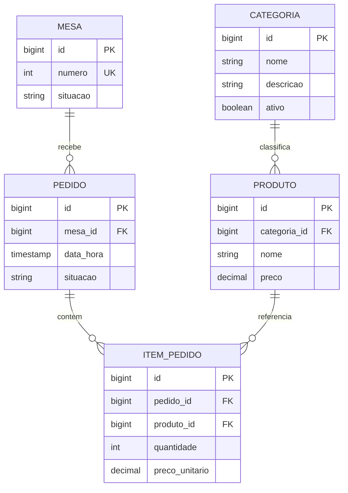

# Modelo de Entidades — Restaurante

## Objetivo

Apresentar os relacionamentos entre as entidades
do sistema de restaurante SOAP e REST.

## Diagrama de entidades

## Explicação dos relacionamentos

### Mesa e Pedido
Uma mesa pode receber vários pedidos ao longo do tempo.

### Categoria e Produto
Uma categoria pode classificar vários produtos.

### Pedido e ItemPedido
Um pedido pode conter vários itens.

### Produto e ItemPedido
Um produto pode aparecer em vários itens de pedidos.

## Conceitos importantes

- PK: chave primária.
- FK: chave estrangeira.
- UK: chave única.
- 1:N: relacionamento de um para muitos.

